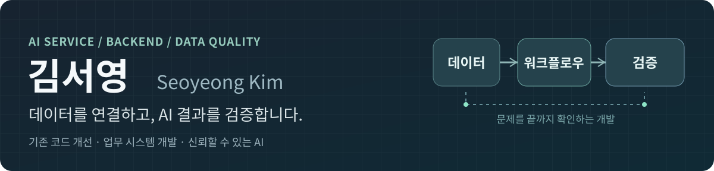

  

  <a href="https://github.com/Westzer00/exem-ai-workflow">💻 EXEM 개발 코드</a> &nbsp;·&nbsp;
  <a href="https://github.com/Westzer00/voice-phishing-stt-qc-pipeline">🎙️ STT 검수 코드</a> &nbsp;·&nbsp;
  <a href="mailto:k953609@gmail.com">✉️ 이메일</a>

## 🧩 대표 프로젝트

<table>
  <tr>
    <td width="21%" align="center" valign="middle">
      <h2>🔁</h2>
      <strong>LOOP 백엔드</strong> 
      기존 플랫폼 개선
    </td>
    <td width="79%" valign="top">
      <strong><a href="https://github.com/Westzer00/exem-ai-workflow">EXEM · AI 워크플로우 및 PHISIGHT</a></strong> 
      2026.07~10 · 5인 기업연계 프로젝트 · 공공기관 협업 과제
      
<strong>문제</strong> — 반복 실행 중 여러 노드의 결과를 다음 회차에 구분해서 전달하기 어려웠습니다.

      
<strong>개인 구현</strong> — LOOP 입출력 바인딩, 이전 회차 참조, 종료 조건을 Python으로 개발하고 테스트했습니다. 사내 PR·코드 리뷰를 거쳤습니다.

      
<strong>협업</strong> — PHISIGHT 화면 흐름 설계 및 상세 UI 공동 개발.

      
<a href="https://github.com/Westzer00/exem-ai-workflow/tree/main/backend">코드·테스트</a> · <a href="https://github.com/Westzer00/exem-ai-workflow/blob/main/docs/development-review.md">개발 과정</a> · <a href="https://github.com/Westzer00/exem-ai-workflow/blob/main/docs/ui-participation.md">UI 화면</a>

    </td>
  </tr>
  <tr>
    <td align="center" valign="middle">
      <h2>🏭</h2>
      <strong>제조업 AI</strong> 
      현업 데이터 통합
    </td>
    <td valign="top">
      <strong>BLI · 제조업 데이터 통합 및 AI 업무 플랫폼</strong> 
      2026.09~현재 · 2인 개발 · 실제 기업 업무 적용
      
<strong>문제</strong> — 발주부터 생산·수출·회계까지 데이터가 부서별로 흩어져 있었습니다.

      
<strong>개인 구현</strong> — 품목·거래처·발주를 데이터 모델로 정리하고 기존 MES와 연동했습니다. TypeScript 기반 API, AI 조회, 문서 처리 자동화와 중복 처리 방지 기능을 개발·운영했습니다.

      
내부 코드와 거래처 자료는 비공개입니다.

    </td>
  </tr>
  <tr>
    <td align="center" valign="middle">
      <h2>🎧</h2>
      <strong>STT 품질 검수</strong> 
      오류 선별·사람 검토
    </td>
    <td valign="top">
      <strong><a href="https://github.com/Westzer00/voice-phishing-stt-qc-pipeline">보이스피싱 음성인식 검수 파이프라인</a></strong> 
      EXEM 기업연계 프로젝트 · 개인 개발 코드 공개
      
<strong>문제</strong> — 음성인식 신뢰도가 높아도 금액·기관명 같은 중요한 정보가 틀릴 수 있었습니다.

      
<strong>개인 구현</strong> — 오류 의심 구간 선별, 화자 정렬, 원음 비교·수정용 검수 화면.

      
<strong>팀 성과</strong> — 통화 511건 처리, 5,152개 검수 후보 선별, 최종 398건의 검증 데이터셋 구축에 참여했습니다.

      
<a href="https://github.com/Westzer00/voice-phishing-stt-qc-pipeline">코드·실행 방법</a> · <a href="https://github.com/Westzer00/voice-phishing-stt-qc-pipeline/actions">자동 테스트</a>

    </td>
  </tr>
</table>

## 📂 다른 프로젝트

| 프로젝트 | 구현과 검증 내용 |
|:---|:---|
| 🧴 **[화장품 신제품 위험 선별 ML](https://github.com/Westzer00/cosmetic-coldstart-risk-ml)** | 출시 전 입력 변수 설계와 데이터 누수 방지 검증. **4인 팀장·제1저자 학술발표** |
| 🎬 **[영상 관심 구간 검색·평가](https://github.com/Westzer00/univtg-creator-segment-retrieval)** | UniVTG 기반 검색, LLM 질의 설계, 상위 후보 정렬 단계의 성능 병목 분석 |
| 🚀 **[로켓 비행전자 시스템](https://github.com/Westzer00/rocket-avionics-case-study)** | 센서 처리·하강 판단·낙하산 제어 개발 참여, 실제 제작·발사 시험 및 코드·사진 |

## 🛠️ 사용 기술

**서비스·백엔드** &nbsp; `Python` · `TypeScript` · `FastAPI` · `Next.js` · `REST API`

**AI·데이터** &nbsp; `RAG` · `LLM API` · `Whisper` · `NeMo` · `Milvus` · `Pandas`

**개발·검증** &nbsp; `Git` · `Docker` · `pytest` · `GitHub Actions` · `Cloudflare Workers`
