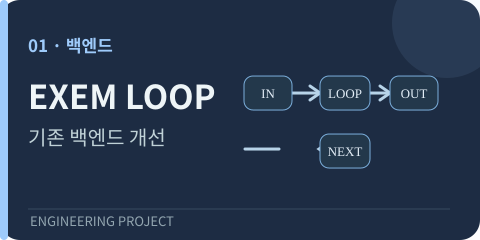
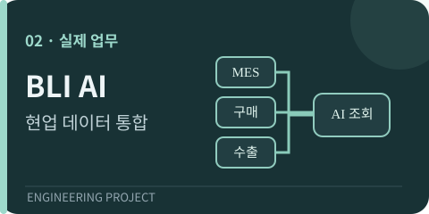
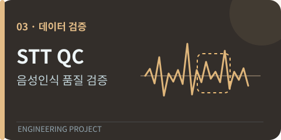

  

  
  
  

<table>
  <tr>
    <td align="center" width="33%">
      <strong>🏭 현업 데이터 연결</strong> 
      분산된 제조 데이터를 정리하고 실제 사용하는 서비스로 구현
    </td>
    <td align="center" width="34%">
      <strong>🔁 기존 플랫폼 개선</strong> 
      워크플로우 실행 구조를 분석하고 Python 백엔드·테스트 개발
    </td>
    <td align="center" width="33%">
      <strong>🛡️ AI 결과 검증</strong> 
      음성인식 오류 선별부터 사람 검토·데이터 품질 관리까지
    </td>
  </tr>
</table>

## 대표 프로젝트

<table>
  <tr>
    <td width="35%" align="center" valign="middle">
      
    </td>
    <td width="65%" valign="top">
      <h3>① <a href="https://github.com/Westzer00/exem-ai-workflow">EXEM · AI 워크플로우 및 LOOP 백엔드</a></h3>
      2026.07~10 · 5인 기업연계 프로젝트 · 공공기관 협업 과제
      
<strong>문제</strong> — 기존 LOOP는 여러 내부 노드의 결과를 다음 회차에 구분해 전달하기 어려웠습니다.

      
<strong>개인 개발</strong> — 입력·출력 바인딩과 이전 회차 결과 참조, 종료 조건을 Python으로 구현하고 테스트했습니다. 사내 PR·코드 리뷰를 거쳤습니다.

      
<strong>서비스 참여</strong> — PHISIGHT 초기 화면·사용자 흐름 설계, 상세 UI 2인 공동 개발.

      
↳ <a href="https://github.com/Westzer00/exem-ai-workflow/tree/main/backend">독립 실행 코드·테스트</a> · <a href="https://github.com/Westzer00/exem-ai-workflow/blob/main/docs/development-review.md">개발·리뷰 과정</a> · <a href="https://github.com/Westzer00/exem-ai-workflow/blob/main/docs/ui-participation.md">UI 화면</a>

    </td>
  </tr>
  <tr>
    <td width="35%" align="center" valign="middle">
      
    </td>
    <td width="65%" valign="top">
      <h3>② BLI · 제조업 데이터 통합 및 AI 업무 플랫폼</h3>
      2026.09~현재 · 2인 개발 · 실제 기업 업무에 적용
      
<strong>문제</strong> — 발주·입고·생산·수출·회계 기록이 부서와 시스템마다 분산돼 있었습니다.

      
<strong>개인 개발</strong> — 품목·거래처·발주 정보를 관계형 데이터 구조로 정리하고 기존 MES와 연동했습니다. TypeScript 기반 API, AI 데이터 조회, 문서 자동화 및 중복 처리 방지 기능을 개발·운영했습니다.

      
기업 내부 코드와 거래처 자료는 비공개이며, 그림은 실제 화면이 아닌 업무 흐름 개념도입니다.

    </td>
  </tr>
  <tr>
    <td width="35%" align="center" valign="middle">
      
    </td>
    <td width="65%" valign="top">
      <h3>③ <a href="https://github.com/Westzer00/voice-phishing-stt-qc-pipeline">STT 품질 검수 · Human Review</a></h3>
      EXEM 프로젝트의 개인 담당 영역을 별도 코드로 정리
      
<strong>문제</strong> — 음성인식 신뢰도가 높아도 기관명이나 금액처럼 중요한 정보가 잘못 인식됐습니다.

      
<strong>개인 개발</strong> — 오류 의심 구간 선별, NeMo 화자 정렬, 원음 대조·수정용 Streamlit 검수 화면.

      
<strong>팀 결과</strong> — 통화 <strong>511건</strong>을 처리하고 최종 검증 데이터셋 <strong>398건</strong> 구축에 참여했습니다. 검수 후보 <strong>5,152개</strong>를 선별했습니다.

      
↳ <a href="https://github.com/Westzer00/voice-phishing-stt-qc-pipeline">코드·실행 방법</a> · <a href="https://github.com/Westzer00/voice-phishing-stt-qc-pipeline/actions">자동 테스트</a>

    </td>
  </tr>
</table>

## 다른 프로젝트

<table>
  <tr>
    <td width="33%" valign="top">
      <strong>🧴 <a href="https://github.com/Westzer00/cosmetic-coldstart-risk-ml">신제품 위험 선별 ML</a></strong> 
      리뷰가 없는 신제품의 입력 변수 설계와 데이터 누수 방지 검증. <strong>4인 팀장·제1저자 학술발표.</strong>
    </td>
    <td width="34%" valign="top">
      <strong>🎬 <a href="https://github.com/Westzer00/univtg-creator-segment-retrieval">영상 구간 검색·평가</a></strong> 
      영상별 LLM 질의·UniVTG 검색 구현. 성능이 떨어진 원인을 후보 생성과 순위 결정 단계로 나눠 분석.
    </td>
    <td width="33%" valign="top">
      <strong>🚀 <a href="https://github.com/Westzer00/rocket-avionics-case-study">로켓 비행전자 시스템</a></strong> 
      센서 데이터 처리와 하강 판단, 실제 발사 시험 참여. 독립 실행 예제와 제작·비행 사진 공개.
    </td>
  </tr>
</table>

## 사용 기술

  
  
  
  
  
  

  <strong>AI·데이터:</strong> RAG · LLM API · Whisper · NeMo · Milvus · scikit-learn &nbsp;|&nbsp; <strong>개발·검증:</strong> REST API · pytest · GitHub Actions · Cloudflare Workers

---

  <strong>설계만 설명하지 않고, 실제 코드와 테스트로 보여주겠습니다.</strong> 
  기업·팀 성과는 개인 기여와 구분하며, 내부 코드와 원본 개인정보는 공개하지 않습니다.  
  <a href="mailto:k953609@gmail.com">✉️ 이메일</a> &nbsp;·&nbsp; <a href="https://github.com/Westzer00">GitHub</a>

